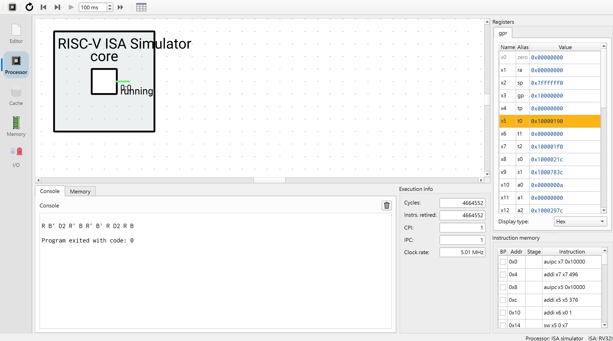
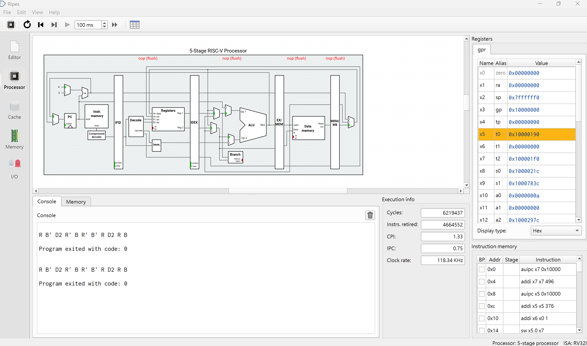
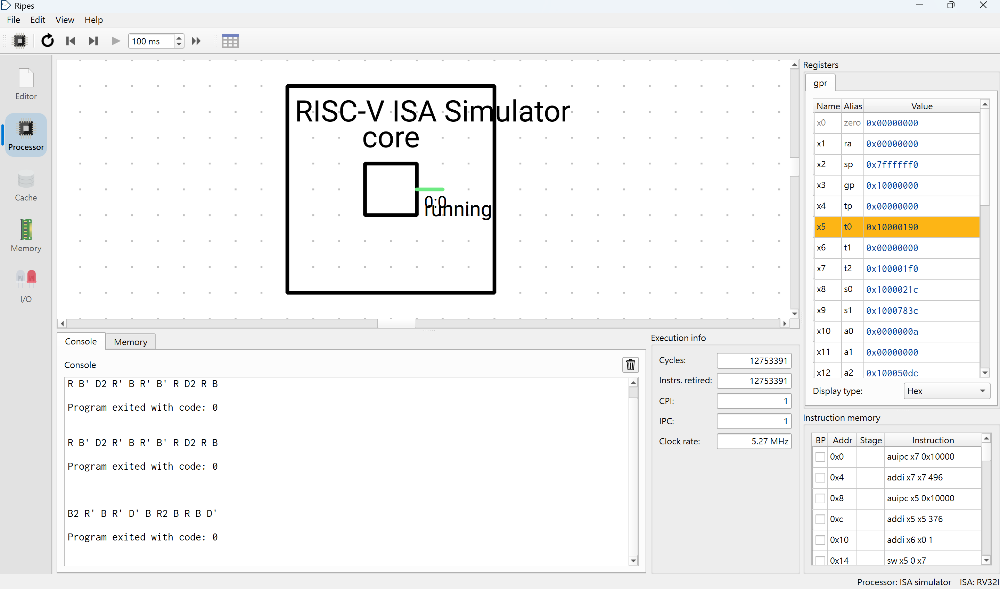
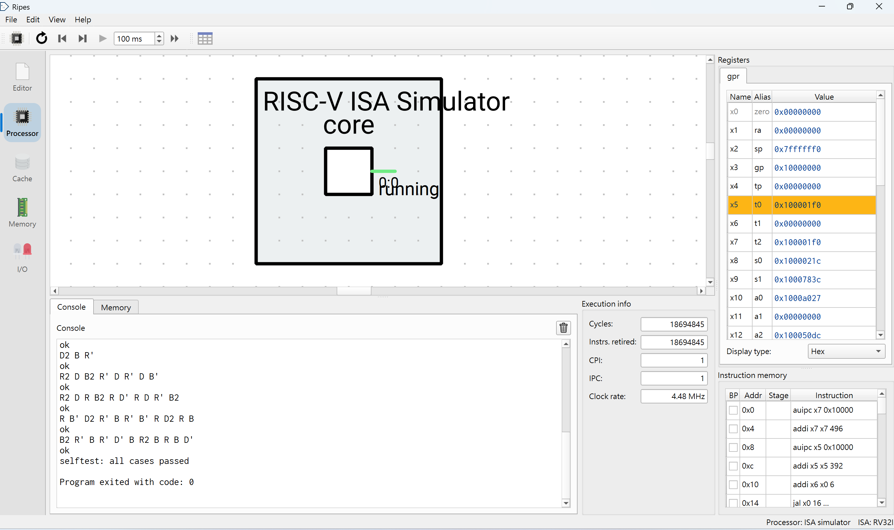
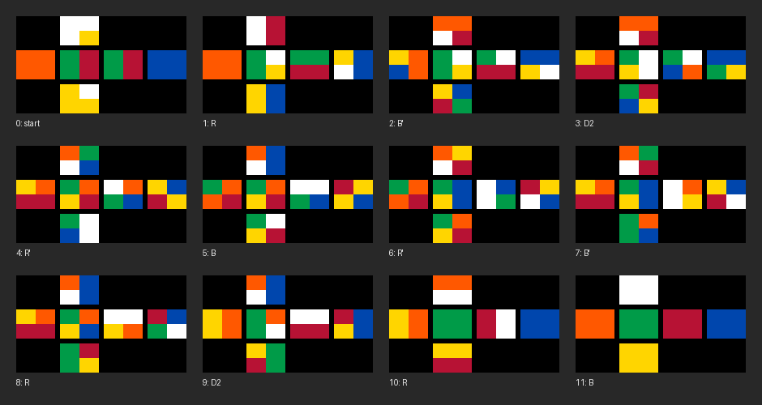
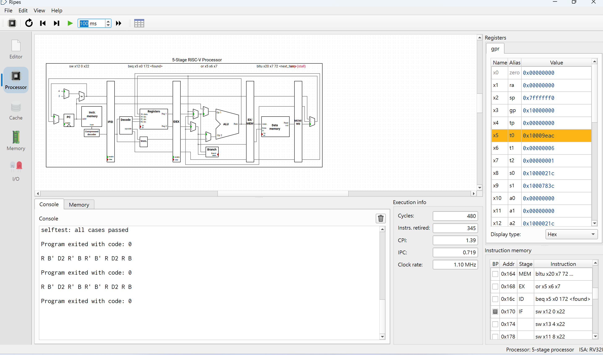
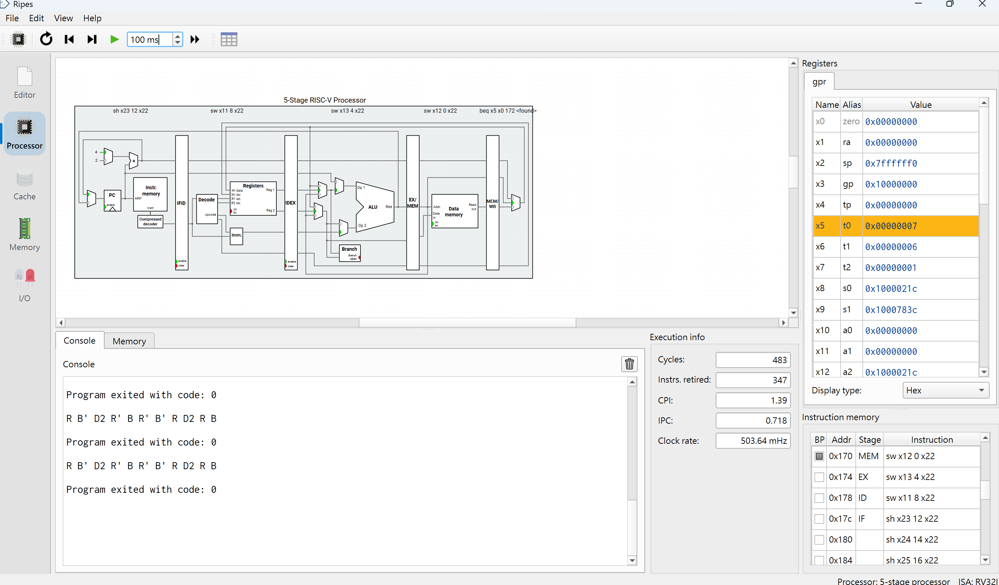

## Stage 4: Translation to RV32I Assembly

### 4.1 Measurement conventions

- **Code size**: bytes of linked `.text`, `RENDER = 0`, `SELFTEST = 0`
- **Retired instructions**: Ripes `--iret`, `RV32_ISS`, renderer compiled out, same input
- **Reference input**: `21345671111111`; **worst case**: `54721631111111` (hardest of the 2,644 distance-11 states)
- Numbers marked *ISS* come from my own RV32I ISS (one retire per instruction); it matches Ripes exactly on both measured states (4,664,552 and 12,753,391), so *ISS* counts equal Ripes `--iret`
- `RENDER = 0` and `RENDER = 1` builds differ **only** in the renderer
- Static data (`.data` + `.rodata`): **41,288 B** ≤ 128 KiB budget

### 4.2 Iterative refinement (measured, *ISS*)

| Step | Change | .text | `21345671111111` | `25416373331111` (d = 10) | `54721631111111` |
|---|---|---:|---:|---:|---:|
| 0 | Original `rubic.s` | — | not measurable: `mul`/`divu`/`remu` fail under `-march=rv32i`; `path` stored garbage from `0(sp)` | | |
| A | Final, but compute `max(h_p, h_o)` before testing | 920 | 5,439,588 | 1,452,564 | 14,871,781 |
| B | Final, but X2/X' re-applied from parent | 932 | 7,316,034 | 1,953,866 | 20,004,291 |
| **Final** | Incremental X→X2→X'; perm-first early exit | **912** | **4,664,552** | **1,246,695** | **12,753,391** |

- A and B are ablations: each reverts one optimization from the final build
- **Incremental turns**: 3 table lookups per face instead of 1 + 2 + 3 = 6; reverting costs **+57%**
- **Perm-first early exit**: skip the orient lookup when `perm_dist > lim`; reverting costs **+17%**
- Case loop + in-program length check add a fixed +65 retired (4,664,487 → 4,664,552); search core unchanged

### 4.3 Test cases and in-program validation

- `SELFTEST = 1` solves 6 built-in cases (state + exact distance):

| State | Source | Distance |
|---|---|---:|
| `12345671111111` | solved | 0 |
| `24173562322133` | scramble `R B' D2` | 3 |
| `62345713133111` | `tests/solutions.txt` | 8 |
| `25416373331111` | `tests/solutions.txt` | 10 |
| `21345671111111` | reference vector | 11 |
| `54721631111111` | hardest distance-11 | 11 |

- Each case is checked **inside the program**:
  - **Replay**: apply the path, must reach rank (0, 0), else `verify failed` (T5)
  - **Optimal length**: length must equal stored distance, else `FAIL: length differs from exact distance`
- All pass → `selftest: all cases passed`
- Normal mode (`SELFTEST = 0`): distance byte = 255, replay check only
- Solutions may differ from `tests/solutions.txt`; optimal solutions are not unique

### 4.4 Correctness gates

- `gates_asm.c` reads tables from `rubic.elf` by symbol and **executes the ELF** in an RV32I ISS (aborts on non-RV32I or misaligned access)
- Ground truth: independent BFS on the cubie model, sharing no table with the program

| Gate | Result |
|---|---|
| Truth | 3,674,160 states, diameter 11, 2,644 at distance 11 |
| **H1** | `max(perm_dist, orient_dist) > d`: **0 / 3,674,160** → PASS |
| **H2** | 0 mismatches vs. cubie model; `perm_dist` max 7, `orient_dist` max 6, solved = 0 → PASS |
| **H3** | All 3,674,160 states run on `rubic.elf`: replay solved and length = exact, **0 wrong**; **2,959 s** wall (2 workers) → PASS |
| H4 | N/A: no packed tables |

- **Negative test**: `perm_dist[9]` 1 → 8 in the ELF ⇒ H1 reports 92 violations, H2 FAIL
- H3 stats (*ISS*): mean 324,059; distance-11 worst 12,753,391, best 2,817,005 (4.5×); full ranking in `d11_asm.txt`

**Ripes (T6, T7)**

| Input | Processor | Cycles | Instrs. retired | CPI | Output |
|---|---|---:|---:|---:|---|
| `21345671111111` | ISA simulator (RV32_ISS) | 4,664,552 | **4,664,552** | 1.00 | `R B' D2 R' B R' B' R D2 R B` |
| `21345671111111` | 5-stage processor | 6,219,437 | **4,664,552** | 1.33 | `R B' D2 R' B R' B' R D2 R B` |
| `54721631111111` | ISA simulator (RV32_ISS) | 12,753,391 | **12,753,391** | 1.00 | `B2 R' B R' D' B R2 B R B D'` |
| `SELFTEST = 1` | ISA simulator (RV32_ISS) | 18,694,845 | **18,694,845** | 1.00 | 6 × `ok`, `selftest: all cases passed` |

- Both models retire the same 4,664,552 instructions and print the same optimal 11-move solution, exit code 0 (T6, T7)
- Ripes count equals my ISS count exactly, which validates every *ISS* figure in this note
- Selftest: all 6 cases return the exact optimal length and replay to solved, checked inside the program
- 5-stage: 1,554,885 extra cycles (CPI 1.33) come from branch flushes (`nop (flush)` in IF/ID/EX/MEM) and load-use stalls; the IDA\* inner loop is branch-dense









### 4.5 vs. GCC -O2

- Reference: `gcc_ref.c` = `perm_rank`, `orient_rank`, `heuristic`, `search` copied **unchanged** from my final `solver.c` (PRECOMPUTED tables), plus a harness doing the same job as `rubic.s` (parse inlined state, solve, replay-check, print via ecall)
- Build (GCC 13.2.0):

```
riscv64-unknown-elf-gcc -O2 -march=rv32i -mabi=ilp32 -ffreestanding -nostdlib -nostartfiles \
  -Wl,-Ttext=0 -Wl,-Tdata=0x10000000 -Wl,-e,_start gcc_ref.c -o gcc_ref.elf   # needs gcc_ref_tables.h
```

- `-nostdlib`: any `__mulsi3`/`__divsi3` call would fail to link; it links, and the disassembly has no `mul`/`div`/`rem`
- Both builds print the **same solutions**, so they explore the same search tree

| | .text (B) | `21345671111111` | `54721631111111` (worst d = 11) |
|---|---:|---:|---:|
| GCC -O2 | 1,532 | 13,438,401 | 36,743,689 |
| Hand-written | **912** | **4,664,552** | **12,753,391** |
| Hand-written / GCC | 0.60× | 0.35× (**2.88× fewer**) | 0.35× (**2.88× fewer**) |

- GCC retired counts: *ISS* (matched Ripes exactly on the hand-written build); Ripes: `Ripes.exe --mode cli -t elf --src gcc_ref.elf --proc RV32_ISS --all`
- Tables are identical in both (GCC `.rodata` 40,472 B), so `.text` compares code only

**Why the hand-written version wins (from GCC's disassembly)**
- **Depth arrays live on the stack**: GCC keeps `p[]`, `o[]`, `face[]`, `turn[]` in memory and reloads/stores them every node (`lhu a2,64(sp)`, `sh a1,66(sp)`, `sb zero,24(sp)`); hand-written keeps the current node in `s7`–`s10` and spills only on descend/backtrack
- **`path[d]` written every node**: `path[d] = first_move[face[d]] + turn[d]` runs on each visit; hand-written stores the move only in the frame on descend
- **Face as index, not pointer**: GCC recomputes `&perm_move[f][x]` from `f` each step; hand-written walks face pointers (`add a2, a2, t6`)
- **Full `max(h_p, h_o)` every node**: C computes both lookups and the max, then `d + 1 + h <= bound`; hand-written tests `h_p` first and exits early with one `bltu` against a precomputed `lim` (ablation A: this alone is worth 17%)
- **Control flow**: the C `goto`/nested-loop structure compiles into extra jumps and `face[d] == (d ? face[d-1] : 3)` re-evaluation per face; hand-written compares face pointers (`beq a2, a1`)
- Unused budget: 41 KiB / 128 KiB; a larger PDB could raise h further (not implemented, no claim)

### 4.6 LED Matrix

- Setup: LED Matrix **Width 35, Height 25**; set `.equ RENDER, 1`; `DELAY` sets frame wait
- Layout: net with U on top, L F R B across, D below; facelet 4 × 3 px, 1 px separators, 35 × 20
- Geometry: `geometry.py` brute-forces `source[][]` → **unique** solution
  - 0 URF, 1 DRF, 2 DLF, 3 URB, 4 DRB, 5 DLB, 6 ULB; ULF fixed; R, B, D clockwise
  - Orientation: U/D sticker is reference; `o` = its slot (counter-clockwise from outside)
- Draw rule: slot k of position i shows sticker `(k − o[i]) mod 3` of cubie `p[i]`
- Driven by solver output: draw start state; after each printed move, apply it to the cubie state and redraw
- Memory: one word per LED, row-major `y * 35 + x`, base `LED_MATRIX_0_BASE`; 12 `sw` per facelet (row stride 140 B)
- Verified: every frame of 6 states matches the independent sticker model pixel-for-pixel; last frame solved



### 4.7 Ripes 5-stage pipeline walkthrough

- `RV32_5S` (forwarding + hazard detection), `rubic_ripes.s` (`RENDER = 0`), input `21345671111111`
- Breakpoint on `0x170 sw x12 0 x22` (`sw a2, 0(s6)`: first spill of IDA\* descend); two snapshots, 3 cycles apart

**Cycle 480: load-use stall**



| Stage | Instruction (PC) |
|---|---|
| IF | `sw x12 0 x22` (0x170) |
| ID | `beq x5 x0 <found>` (0x16c) |
| EX | `or x5 x6 x7` (0x168) |
| MEM | `bltu x20 x7 <next_turn>` (0x164) |
| WB | bubble `(stall)` (—) |

- **WB bubble**: `lbu x7, 0(x5)` (0x160) loads `orient_dist`, and the next instruction `bltu` needs `x7` in EX; MEM-stage data is not ready, so the hazard unit stalls one cycle
- This load-use pattern (`lbu` then compare) is in every node evaluation, one source of CPI 1.33 on 5-stage
- `or x5 x6 x7` in EX: `t1 = 6` (h_perm), `t2 = 1` (h_orient), both read without forwarding conflicts

**Cycle 483: `sw` writes memory**



| Stage | Instruction (PC) |
|---|---|
| IF | `sh x23 12 x22` (0x17c) |
| ID | `sw x11 8 x22` (0x178) |
| EX | `sw x13 4 x22` (0x174) |
| MEM | `sw x12 0 x22` (0x170) |
| WB | `beq x5 x0 <found>` (0x16c) |

- `t0 = 6 | 1 = 7 ≠ 0` (x5 = 0x7 in the register panel), so `beq` was **not taken** in EX: no flush, the `sw` sequence flows straight through
- **IF**: PC + 4 selected; `sh` fetched
- **ID**: `sw x11 8 x22` reads `s6` (base) and `a1` (data); store, so no register write is scheduled
- **EX**: `sw x13 4 x22`: Op1 = `s6`, Op2 = immediate 4; ALU computes the address `s6 + 4`
- **MEM**: `sw x12 0 x22`: ALU result `s6 + 0` drives `Addr.`, `a2` drives `Data in`, Data memory `Wr en` = 1: the current face's perm table pointer is written into `frame[d]`
- **WB**: `beq` writes no register: Registers `Wr En` = 0
- **No hazard**: `s6` was last written by `addi s6, s6, 32` on the previous descend, long since written back; `a1`, `a2`, `a3` are likewise stable

**Why the memory update is correct**
- Each descend spills `a2, a3, a1, s7, s8, s9, s10, a0` into `frame[d]` at `s6 + 0..20`; backtrack restores them with `lw/lhu/lbu` from the same offsets
- Correctness of the whole search is checked by in-program replay and by host H3 on all 3,674,160 states
